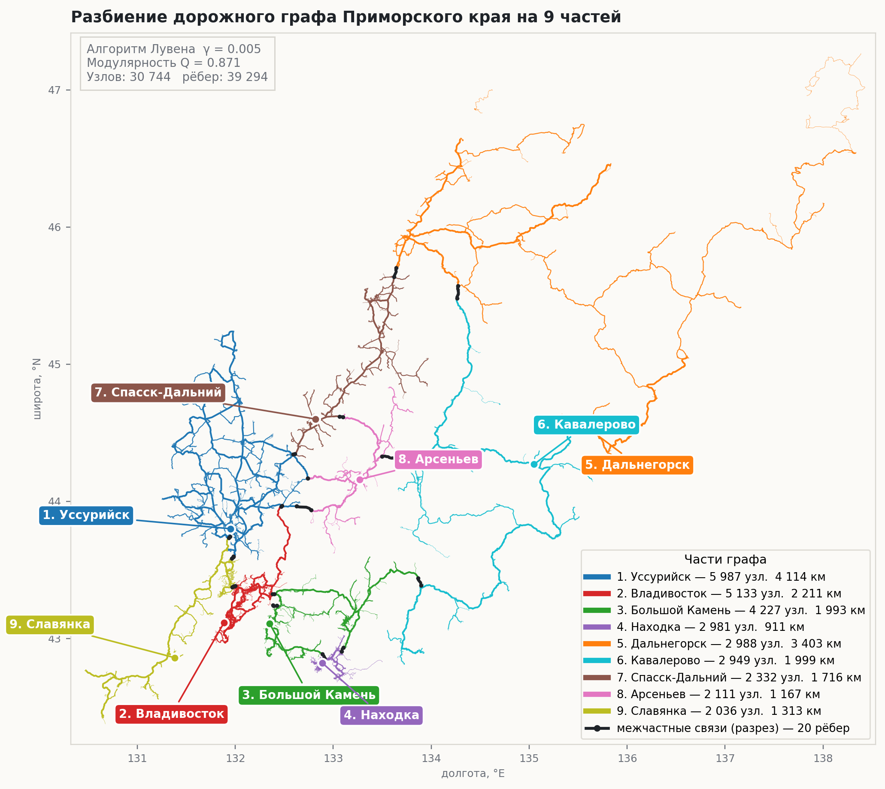
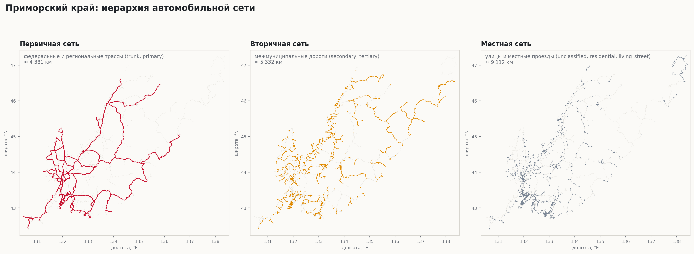
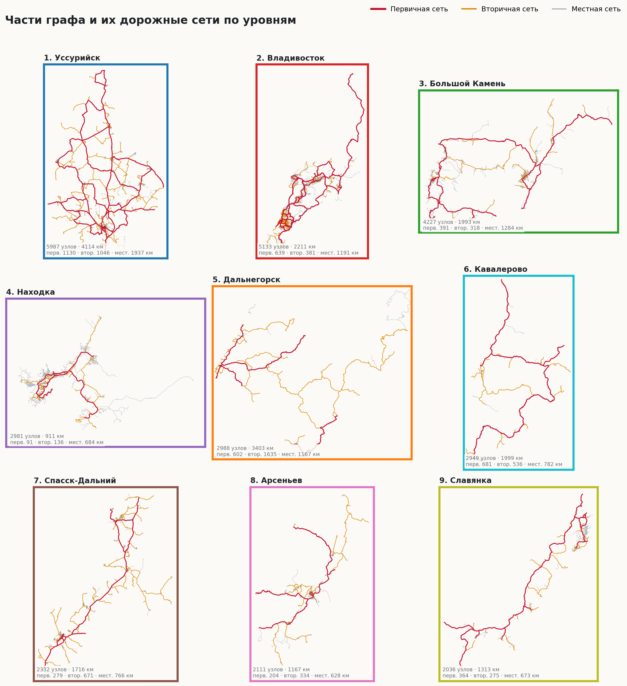
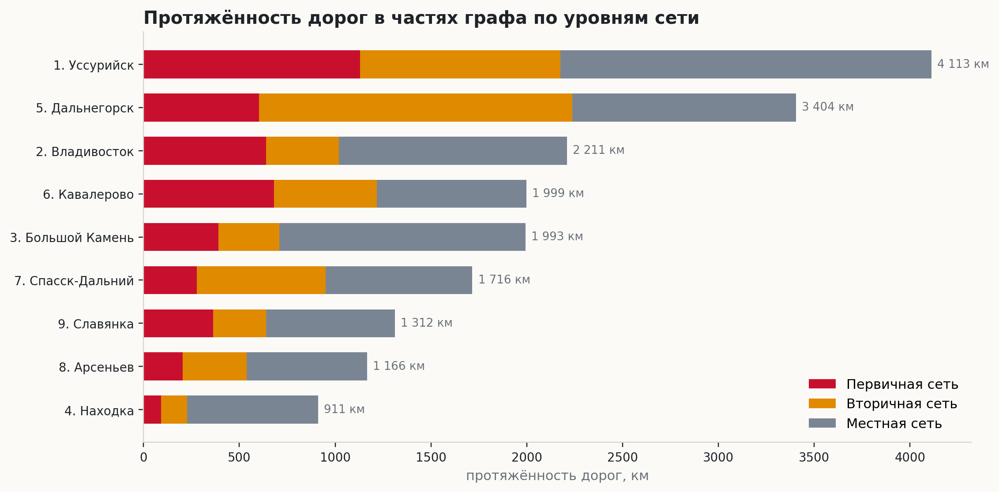

# Граф Приморья: разбиение дорожной сети края на транспортные районы

Автомобильная сеть Приморского края из OpenStreetMap как граф: **30 744 узла, 39 294 ребра, ≈ 18 800 км дорог**.
Скрипт делит сеть на уровни (трассы / межмуниципальные / местные дороги) и разбивает граф на транспортные районы алгоритмом Лувена.



## Результат

- **9 частей**, модулярность **Q = 0.871**: связей внутри частей много, между частями мало.
- Между частями всего **20 разрезанных рёбер** из ~39 тыс., то есть районы почти независимы и соединены считаными дорогами.
- Части названы по крупнейшему городу: Уссурийск, Владивосток, Большой Камень, Находка, Дальнегорск, Кавалерово, Спасск-Дальний, Арсеньев, Славянка.

| № | Часть | Узлов | Первичная, км | Вторичная, км | Местная, км | Всего, км |
|---|-------|------:|------:|------:|------:|------:|
| 1 | Уссурийск | 5 987 | 1 130 | 1 046 | 1 937 | 4 114 |
| 2 | Владивосток | 5 133 | 639 | 381 | 1 191 | 2 211 |
| 3 | Большой Камень | 4 227 | 391 | 318 | 1 284 | 1 993 |
| 4 | Находка | 2 981 | 91 | 136 | 684 | 911 |
| 5 | Дальнегорск | 2 988 | 602 | 1 635 | 1 167 | 3 403 |
| 6 | Кавалерово | 2 949 | 681 | 536 | 782 | 1 999 |
| 7 | Спасск-Дальний | 2 332 | 279 | 671 | 766 | 1 716 |
| 8 | Арсеньев | 2 111 | 204 | 334 | 628 | 1 167 |
| 9 | Славянка | 2 036 | 364 | 275 | 673 | 1 313 |

## Как это работает

1. **Загрузка графа** из `data/primorye.graphml` (выгрузка OSMnx).
2. **Иерархия сети.** Каждое ребро получает уровень по тегу `highway`:
   первичная (`trunk`, `primary`), вторичная (`secondary`, `tertiary`), местная (`residential`, `unclassified`, `living_street`).
3. **Разбиение.** Ориентированный мультиграф сводится к неориентированному, затем `networkx.community.louvain_communities` (γ = 0.005, seed = 42).
   Мелкие фрагменты (< 1 % узлов) присоединяются к ближайшей крупной части.
4. **Именование частей** по ближайшему к центру города узлу.
5. **Статистика и визуализация:** протяжённость дорог по уровням, карты, диаграммы, GraphML с атрибутами `part` и `level` для Gephi/QGIS.

## Визуализации

| Иерархия сети | Части и их дороги |
|---|---|
|  |  |



## Запуск

```bash
python3 -m venv .venv
source .venv/bin/activate
pip install -r requirements.txt
python partition.py
```

Результаты появятся в папке `out/`.

## Стек

Python · NetworkX · NumPy · SciPy · Matplotlib · данные OpenStreetMap

## Планы

Проект в развитии. Дальше хочется:
- учитывать длину дорог как вес рёбер при разбиении;
- сравнить Лувена с другими методами (Leiden, спектральная кластеризация);
- найти «узкие места» сети: дороги, без которых районы теряют связь.
